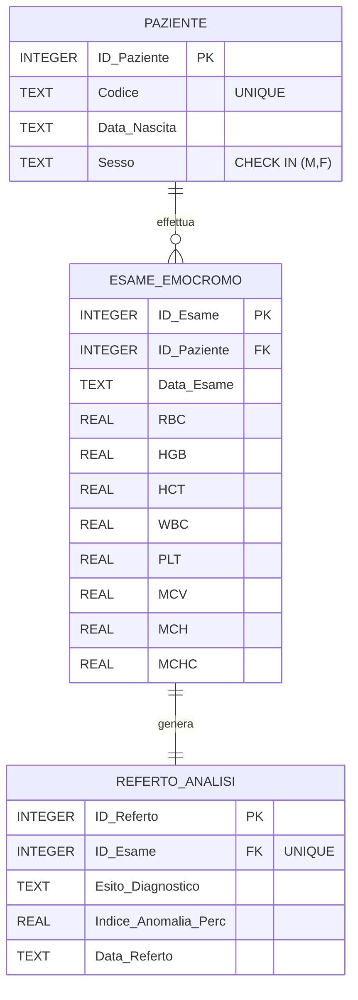

# EmocromoAnalyzer - Gestione & Analisi Emocromo

**EmocromoAnalyzer** è un'applicazione desktop sviluppata in MATLAB App Designer integrata con un database relazionale SQLite. L'obiettivo del progetto è automatizzare l'analisi dei parametri ematologici (emocromo) e fornire diagnosi automatica di anomalie.

---

## Indice

1. [Funzionalità Principali](#funzionalità-principali)
2. [Requisiti e Setup](#requisiti-e-setup)
3. [Guida di Avvio](#guida-di-avvio)
4. [Architettura del Database](#architettura-del-database)
5. [Struttura del Progetto](#struttura-del-progetto)
6. [Descrizione Clinica dei Parametri](#descrizione-clinica-dei-parametri)
7. [Algoritmi Diagnostici](#algoritmi-diagnostici)
8. [Troubleshooting](#troubleshooting)
9. [Background Scientifico](#background-scientifico)

---

## Funzionalità Principali

- **Input Parametri Clinici**: Inserimento e validazione di parametri ematologici (Sesso, HGB, RBC, WBC, PLT, MCV, MCH, MCHC)
- **Diagnosi Automatica**: Rilevamento in tempo reale di anomalie (Anemia Microcitica/Normocitica, Piastrinopenia, Anomalia Leucocitaria)
- **Visualizzazione Grafica**: Grafico a barre interattivo su UIAxes con normalizzazione percentuale e linea di riferimento al 100%
- **Database Relazionale**: Integrazione SQLite con 3 tabelle collegate tramite chiavi esterne
- **Storico Dinamico**: Visualizzazione tabellare degli ultimi pazienti con query LEFT JOIN e gestione valori nulli
- **Gestione Pazienti**: Codice paziente univoco, data di nascita, storico esami

---

## Requisiti e Setup

### Software Necessario

| Requisito | Versione | Note |
|-----------|----------|------|
| MATLAB | R2020b o successiva | Richiesto |
| Database Toolbox | - | Supporto nativo `sqlite` |
| VS Code | - | Opzionale (per gestire il repo e il CSV) |

### Step 1: Preparazione

Clona o scarica il repository e apri in MATLAB la cartella che contiene gli script:

```bash
git clone https://github.com/nicollette26/progetto.git
cd progetto
```

### Step 2: Verifica i File Necessari

Assicurati di avere questi file nella cartella del progetto:

- `crea_database.m` - Script per creare lo schema SQLite
- `prepara_dataset.m` - Verifica struttura e valori del dataset
- `popola_database.m` - Script per popolare il DB dal CSV
- `diagnostica_emocromo.m` - Calcola la diagnosi ed è usata dall'app e dallo script di popolamento
- `valida_emocromo.m` - Valida i parametri prima del popolamento del database
- `blood_count_dataset_clean.csv` - Dataset con i dati dei pazienti già pulito e deduplicato usato dal progetto
- `EmocromoAnalyzer.mlapp` - Applicazione App Designer
- `cartella: foto interfaccia grafica` - Immagini utilizzate nell'interfaccia grafica 

---

## Guida di Avvio

### Procedura Standard

**NOTE AGGIUNTIVE:**
- Il programma usa esclusivamente `blood_count_dataset_clean.csv`
- I file MATLAB, inclusi gli script e i file App Designer, devono essere salvati tutti all'interno della stessa cartella, inoltre estrarre le immagini all'interno della cartella "foto interfaccia grafica" per averle come file singoli nella cartella del progetto

Apri MATLAB nella cartella del progetto e segui questi passaggi in ordine:

#### 1️. **Crea il Database**

Digita nel Command Window di MATLAB:

```matlab
crea_database
```

**Output atteso:**
```
----------------------------------------------------
 Database "emocromo.db" creato con successo! 
----------------------------------------------------
```

Se vedi un errore, vai alla sezione [Troubleshooting](#troubleshooting).

#### 2️. **Verifica del CSV**

Per controllare il CSV senza modificarlo:

```matlab
prepara_dataset
```
`prepara_dataset.m` controlla le colonne richieste, rimuove duplicati e filtra righe non valide in memoria; non modifica il file CSV.

#### 2️. **Popola il Database dal CSV**

Digita:

```matlab
popola_database
```

**Output atteso:**
```
Database pulito. Inizio inserimento dei dati...
----------------------------------------------------
 Database popolato correttamente senza valori NULL! 
----------------------------------------------------
```

> **Importante**: Il file `blood_count_dataset_clean.csv` deve trovarsi nella stessa cartella di `popola_database.m`. Controlla che le colonne del CSV siano esattamente:
> - `Age`, `Gender`, `Hemoglobin`, `Red_Blood_Cells`, `White_Blood_Cells`, `Platelet_Count`, `MCV`, `MCH`, `MCHC`

#### 3️. **Avvia l'Applicazione**

Digita:

```matlab
appdesigner EmocromoAnalyzer.mlapp
```

L'app si apre in MATLAB App Designer. Clicca il pulsante **▶ Run** (in alto) per eseguire l'applicazione.

---

## Architettura del Database

Il database SQLite (`emocromo.db`) è composto da **3 tabelle relazionali**:

### Tabella PAZIENTE
```
ID_Paziente (PK, AUTOINCREMENT)
├─ Codice (VARCHAR, UNIQUE) - Identificativo univoco (es. PAZ_001)
├─ Data_Nascita (DATE) - Anno di nascita approssimativo
> **Nota sull'età e sulla data di nascita:** il campo `Data_Nascita` non contiene la vera data di nascita del paziente. Lo script `popola_database.m` legge `Age` dal CSV e calcola approssimativamente l'anno come `anno corrente - età`, usando il 1° gennaio come data convenzionale
└─ Sesso (CHAR, CHECK IN ('M', 'F'))
```

### Tabella ESAME_EMOCROMO
```
ID_Esame (PK, AUTOINCREMENT)
├─ ID_Paziente (FK) → PAZIENTE(ID_Paziente)
├─ Data_Esame (DATE, DEFAULT CURRENT_DATE)
├─ RBC, HGB, HCT, WBC, PLT (REAL) - Parametri ematologici
└─ MCV, MCH, MCHC (REAL) - Indici eritrocitari
```

### Tabella REFERTO_ANALISI
```
ID_Referto (PK, AUTOINCREMENT)
├─ ID_Esame (FK, UNIQUE) → ESAME_EMOCROMO(ID_Esame)
├─ Esito_Diagnostico (TEXT) - Es. "Anemia Microcitica"
├─ Indice_Anomalia_Perc (REAL) - Gravità 0-100%
└─ Data_Referto (DATE, DEFAULT CURRENT_DATE)
```

### Diagramma ER (Entity Relationship)



---

## Struttura del Progetto

```
progetto/
├── README.md                            # Questo file
├── crea_database.m                      # Script creazione schema DB
├── prepara_dataset.m                    # Script verifica struttura e valori del dataset
├── popola_database.m                    # Script popolo DB da CSV
├── diagnostica_emocromo.m               # Funzione diagnostica usata dall'app e dal popolamento
├── valida_emocromo.m                    # Funzione di validazione usata dal popolamento
├── EmocromoAnalyzer.mlapp               # App Designer (interfaccia grafica)
├── blood_count_dataset_clean.csv        # Dataset con dati pazienti già pulito e deduplicato usato dal progetto
├── emocromo.db                          # Database SQLite (creato in runtime)
└── foto interfaccia grafica             # Immagini dell'interfaccia, se utilizzate
```
**File generati durante l'esecuzione**
Il database emocromo.db non è incluso nel repository: crea_database() e popola_database() lo creano in prefdir di MATLAB. Per sapere dove si trova sul tuo computer, esegui:
`prefdir`
Gli script e il file .mlapp devono essere nella cartella del progetto o comunque nel MATLAB path. È consigliato mantenere il CSV accanto a popola_database.m.

### File Descrizione

| File | Tipo | Scopo |
|------|------|-------|
| `crea_database.m` | MATLAB Script | Crea tabelle SQLite con indici |
| `prepara_dataset.m` | MATLAB Script | Verifica struttura e valori del dataset |
| `popola_database.m` | MATLAB Script | Legge CSV e inserisce dati nel DB |
| `diagnostica_emocromo.m` | Funzione MATLAB | Analizza HGB, WBC, PLT, MCV, MCH E MCHC; restituisce esito e indice di anomalia
| `valida_emocromo.m` | Funzione MATLAB | Controlla i parametri prima dell'inserimento dei dati dal CSV
| `EmocromoAnalyzer.mlapp` | App Designer | Interfaccia grafica + logica applicativa |
| `blood_count_dataset_clean.csv` | Dataset | Dati paziente con parametri ematologici, pulito e deduplicato |
| `emocromo.db` | SQLite Database | Database relazionale (generato automaticamente) |

---

## Descrizione Clinica dei Parametri

### Globuli Rossi e Trasporto di Ossigeno

**HGB (Emoglobina)** [g/dL]
- Proteina nei globuli rossi che trasporta ossigeno dai polmoni ai tessuti
- Valori normali: Donne 12-16 g/dL | Uomini 13.5-17.5 g/dL
- Basso = Anemia → Meno ossigeno ai tessuti

**RBC (Globuli Rossi / Eritrociti)** [10⁶/μL]
- Numero totale di globuli rossi
- Responsabili del trasporto di O₂ e CO₂
- Valori normali: Donne 4.0-5.2 | Uomini 4.5-5.9

**HCT (Ematocrito)** [%]
- Percentuale di sangue occupata da globuli rossi
- Valori normali: Donne 36-46% | Uomini 41-53%
- Calcolato automaticamente: HCT = RBC × MCV / 10

### Globuli Bianchi (Sistema Immunitario)

**WBC (Globuli Bianchi / Leucociti)** [cellule/μL]
- Numero totale di cellule immunitarie nel sangue
- Difendono da infezioni (batteriche, virali, fungine)
- Valori normali: 4,000 - 11,000 leucociti/μL
- Alto/Basso = Sospetta infezione, infiammazione o immunodeficienza

### Piastrine (Coagulazione)

**PLT (Piastrine / Trombociti)** [cellule/μL]
- Cellule fondamentali per la coagulazione del sangue
- Riparano vasi sanguigni in caso di ferite
- Valori normali: 150,000 - 400,000 piastrine/μL
- Basso = Piastrinopenia → Rischio emorragie

### Indici Eritrocitari (Qualità Globuli Rossi)

**MCV (Volume Corpuscolare Medio)** [fL]
- Misura la dimensione media dei globuli rossi
- Valori normali: 80 - 100 fL
- Basso (< 80) = Globuli rossi piccoli (Microcitica)
- Alto (> 100) = Globuli rossi grandi (Macrocitica)

**MCH (Emoglobina Corpuscolare Media)** [pg]
- Quantità media di emoglobina per globulo rosso
- Valori normali: 27 - 33 pg
- Riflette il contenuto di ossigeno trasportabile

**MCHC (Concentrazione Emoglobina Corpuscolare Media)** [g/dL]
- Concentrazione media di emoglobina nei globuli rossi
- Valori normali: 32 - 36 g/dL
- Poco variabile, importante per diagnostica

---

## Algoritmi Diagnostici

L'app implementa logica diagnostica basata su soglie cliniche consolidate:

### 1. **Anemia**

```
SE (Sesso == 'F' AND HGB < 12.0) OR (Sesso == 'M' AND HGB < 13.5) ALLORA
    SE MCV < 80 ALLORA
        Esito = "Anemia Microcitica"
        Indice_Anomalia = 25%
    ALTRIMENTI SE MCV > 100 ALLORA
        Esito = "Anemia Macrocitica"
        Indice_Anomalia = 25%
    ALTRIMENTI
        Esito = "Anemia Normocitica"
        Indice_Anomalia = 25%

    SE MCH < 27 OR MCHC < 32 ALLORA
        Esito = Esito + " / Ipocromica"
```

**Cause comuni:**
- Carenza ferro, B12, acido folico
- Emorragia
- Malattie croniche

### 2. **Anomalia Leucocitaria (WBC)**

```
SE (WBC > 11,000) OR (WBC < 4,000) ALLORA
    Esito = "Anomalia Globuli Bianchi"
    Indice_Anomalia = 30%
```

**Interpretazione:**
- WBC alto → Infezione acuta, leucemia, infiammazione
- WBC basso → Immunodeficienza, chemioterapia, lupus

### 3. **Piastrinopenia**

```
SE PLT < 150,000 ALLORA
    Esito = "Piastrinopenia"
    Indice_Anomalia = 20%
```

**Cause:**
- Consumo aumentato (DIC, ITP)
- Produzione ridotta (aplasia midollare)
- Malattie autoimmuni

### 4. **Gestione delle anomalie multiple**

```
Il sistema può riportare più anomalie nello stesso esito. Sono controllate:

- Anemia: microcitica, normocitica o macrocitica
- Anomalia dei globuli bianchi
- Piastrinopenia

Un esempio di esito combinato è:

```text
Anemia Microcitica / Ipocromica + Anomalia Globuli Bianchi + Piastrinopenia
```

### 5. **Valori nella Norma**

```
SE nessuna condizione sopra ALLORA
    Esito = "Valori nella Norma"
    Indice_Anomalia = 0%

```markdown
L’indice percentuale rappresenta il massimo tra i valori delle anomalie rilevate,
non la somma. Nell’implementazione attuale: anemia 25%, piastrinopenia 20%
e anomalia dei globuli bianchi 30%; quindi un esito combinato può avere indice 30%.
```

## Troubleshooting

### Errore 1: "File blood_count_dataset_clean.csv non trovato"

**Causa:** Il CSV non è stato trovato nello script o nella cartella corrente.

**Soluzione:**

```matlab
% Verifica la cartella corrente
pwd

% Vai nella cartella del progetto
cd('percorso/completo/della/cartella/progetto')

% Verifica che il file sia presente
isfile('blood_count_dataset_clean.csv')
```

Se `isfile` restituisce `0`, inserisci il CSV nella stessa cartella di `popola_database.m` oppure passa esplicitamente il percorso corretto:

```matlab
dataset = prepara_dataset('percorso/completo/blood_count_dataset_clean.csv');
```

### Errore 2: "Subscripting into a table using one subscript ... is not supported"

**Causa:** Non si sta utilizzando la sintassi MATLAB corretta per accedere a una cella di una table.

**Soluzione:**

```matlab
% Sbagliato
eta = dataset.Age(i);

% Corretto
eta = dataset{i, 'Age'};
hgb = dataset{i, 'Hemoglobin'};
```

Se l'errore persiste, verifica che `dataset` sia una table:

```matlab
whos dataset
```

Dovrebbe risultare `table`, non un array o una matrice.

### Errore 3: "FOREIGN KEY constraint failed"

**Causa:** È stata tentata l'inserimento di un esame o di un referto riferendosi a un paziente o a un esame inesistente.

**Soluzione:** In MATLAB chiudi le connessioni SQLite aperte e ricrea il database:

```matlab
clear all
close all

dbPath = fullfile(prefdir, 'emocromo.db');

if isfile(dbPath)
    delete(dbPath);
end

crea_database(dbPath);
popola_database;
```

`emocromo.db` non si trova necessariamente nella cartella del progetto: viene creato nella cartella delle preferenze MATLAB restituita da:

```matlab
prefdir
```

### Errore 4: "Database is locked"

**Causa:** Il database è aperto da un'altra connessione MATLAB, da App Designer o da un programma esterno, come l'estensione SQLite di VS Code.

**Soluzione:**

1. Chiudi l'app di App Designer premendo il pulsante di chiusura.
2. Chiudi le connessioni SQLite aperte.
3. Chiudi eventuali browser o estensioni SQLite.
4. Esegui:

```matlab
clear all
close all
```

Se il problema persiste, chiudi MATLAB, riavvialo e esegui nuovamente:

```matlab
crea_database;
popola_database;
```

### Errore 5: App Designer non si apre o non trova il file `.mlapp`

**Causa:** MATLAB non trova `EmocromoAnalyzer.mlapp` perché si trova in un'altra cartella o il MATLAB path non è configurato.

**Soluzione:**

```matlab
cd('percorso/completo/della/cartella/progetto');
which EmocromoAnalyzer.mlapp
appdesigner('EmocromoAnalyzer.mlapp');
```

Se `which` non restituisce il percorso del file, il comando `cd` non sta indicando la cartella corretta.

In alternativa, aggiungi il progetto al MATLAB path:

```matlab
addpath(pwd);
savepath;
```

### Errore 6: Database o dati non visualizzati nell'app

**Causa:** L'app cerca un database diverso da quello popolato oppure i dati non sono stati inseriti.

**Soluzione:**

1. Verifica il percorso effettivo del database:

```matlab
dbPath = fullfile(prefdir, 'emocromo.db');
disp(dbPath);
isfile(dbPath)
```

2. Ricrea e popola il database:

```matlab
crea_database(dbPath);
popola_database;
```

3. Verifica che il database contenga i dati:

```matlab
conn = sqlite(fullfile(prefdir, 'emocromo.db'), 'readonly');
data = fetch(conn, 'SELECT COUNT(*) AS Numero FROM PAZIENTE');
close(conn);
disp(data)
```

4. Riavvia l'app:

```matlab
appdesigner('EmocromoAnalyzer.mlapp');
```

Assicurati inoltre che il codice dell'app apra proprio:

```matlab
fullfile(prefdir, 'emocromo.db')
```

La tabella contenente i dati principali dei pazienti è `PAZIENTE`.

### Errore 7: Nessun dato inserito o tutte le righe scartate

**Causa:** Alcune righe del CSV vengono escluse perché contengono valori mancanti, non numerici, infiniti o negativi; altre vengono scartate dalla funzione `valida_emocromo`.

**Soluzione:**

```matlab
dataset = prepara_dataset('blood_count_dataset_clean.csv');
disp(height(dataset));
```

Riprova il popolamento:

```matlab
popola_database;
```

Controlla che il CSV contenga esattamente queste colonne:

- `Age`
- `Gender`
- `Hemoglobin`
- `Red_Blood_Cells`
- `White_Blood_Cells`
- `Platelet_Count`
- `MCV`
- `MCH`
- `MCHC`

## Background Scientifico

### Contesto Clinico

L'emocromo (Esame Emocromocitometrico Completo) è uno dei test diagnostici più comuni nella medicina moderna. L'analisi automatizzata dei parametri ematologici è fondamentale per:

1. **Diagnosi differenziale rapida** di anemie, infezioni e disordini emorragici
2. **Monitoring** di pazienti in terapia (chemioterapia, immunoterapia)
3. **Risk stratification** in pazienti critici

### Dataset: Kaggle

Per reperire i dati necessari allo sviluppo del progetto, ho consultato il sito **Kaggle**, una delle piattaforme più importanti per la raccolta di dataset pubblici. In particolare qui ho trovato il dataset utilizzato per il progetto, selezionando un insieme di dati ematologici strutturati e pertinenti all'analisi dell'emocromo

> Consulta per vedere la fonte del dataset: **https://www.kaggle.com/datasets/vizeno/complete-blood-count-cbc-dataset**


---

> [!IMPORTANT]
>  **Avvertenza — uso didattico:** Questo progetto è stato realizzato esclusivamente a scopo didattico e dimostrativo. Le soglie e le regole implementate sono semplificate e non sono state validate per l’uso clinico. I risultati non costituiscono un referto medico, una diagnosi o un’indicazione terapeutica

## Autore e Note di Sviluppo

- **Progetto:** Elaborato Biomedico
- **Linguaggio:** MATLAB (App Designer + SQLite)
